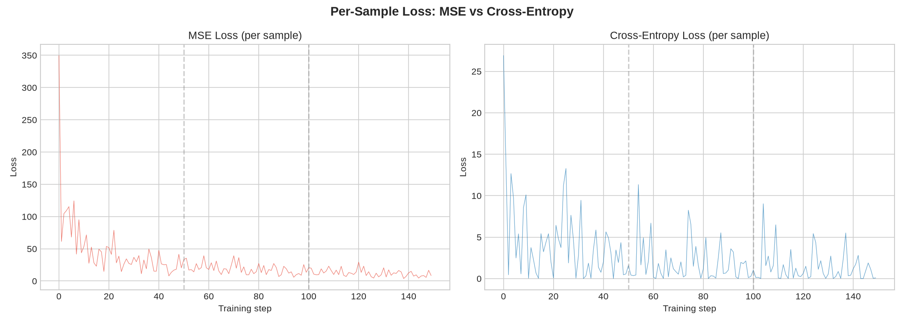
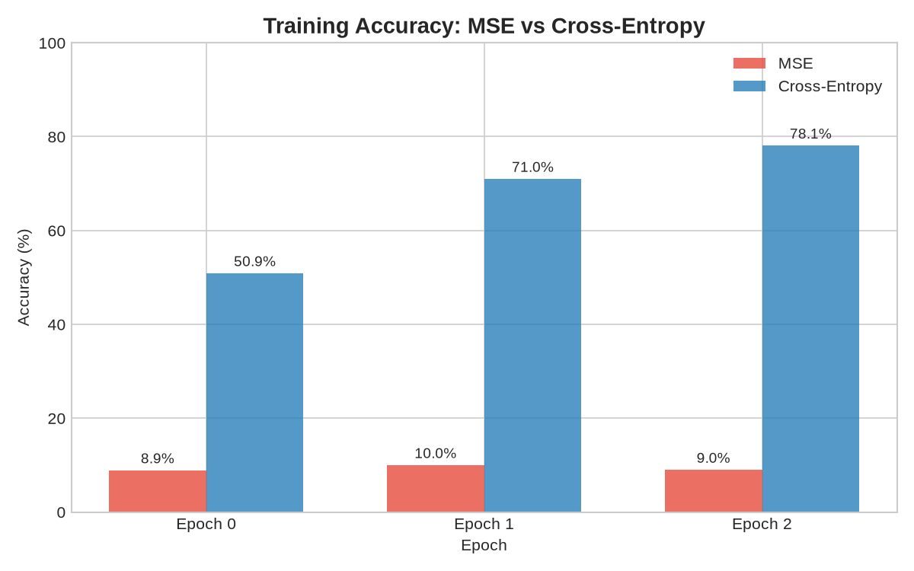
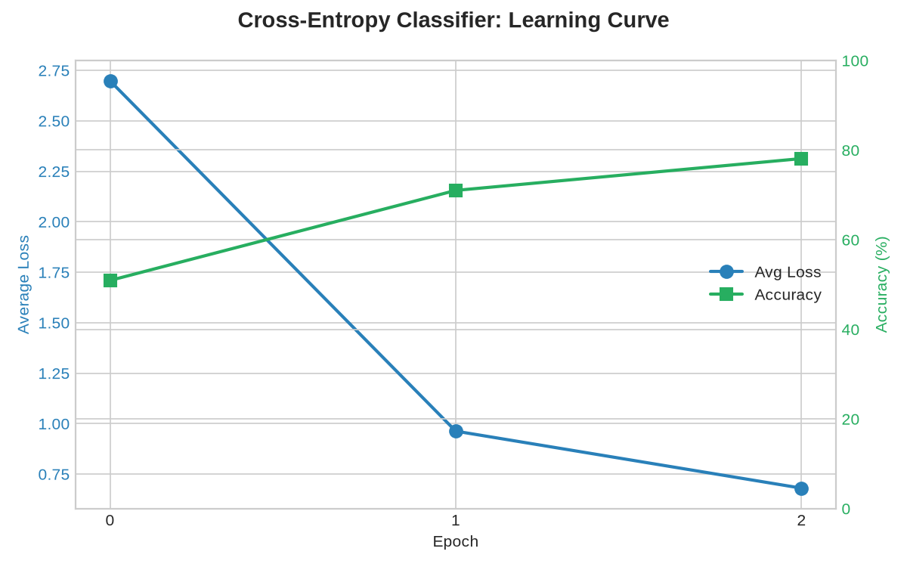

# pgrad

A tiny autograd engine and neural network library built from scratch in Python. Implements reverse-mode automatic differentiation over a dynamically built computation graph, similar to PyTorch's autograd.

## Features

- **Value**: scalar-valued autograd engine with support for `+`, `*`, `**`, `/`, `-`, `relu`, `exp`, `log` and automatic gradient computation via backpropagation
- **Neural network modules**: `Neuron`, `Layer`, and `MLP` built on top of the autograd engine
- **Loss functions**: `softmax` and `cross_entropy` for classification tasks
- **Gradient verification**: finite difference tests to validate backprop correctness

## Usage

```python
from pgrad.engine import Value

a = Value(-4.0)
b = Value(2.0)
c = a + b
d = a * b + b**3
d.backward()

print(a.grad)  # dd/da
print(b.grad)  # dd/db
```

```python
from pgrad.nn import MLP
from pgrad.loss import softmax, cross_entropy

model = MLP(3, [4, 4, 1])
x = [Value(1.0), Value(2.0), Value(3.0)]
output = model(x)
```

## MNIST

Two classifiers trained on 1000 MNIST samples with a 784→30→10 MLP:

- **Naive (MSE loss)**: loss decreases but accuracy stays at ~9% (random chance)
- **Cross-entropy loss**: accuracy reaches 78% train / 62.5% test in 3 epochs

### Per-sample loss



### Training accuracy



### Learning curve (cross-entropy)



```bash
python -u -m pgrad.mnist.classifer        # MSE version
python -u -m pgrad.mnist.classifer_ce     # cross-entropy version
```

## Setup

```bash
python3 -m venv venv
source venv/bin/activate
pip install -e .
pip install scikit-learn matplotlib  # for MNIST
```

## Testing

```bash
python tests/test_engine.py
python -c "from tests.test_nn import test_finite_differences; test_finite_differences()"
```

Tests compare pgrad's forward and backward passes against PyTorch. Finite difference tests verify `exp`, `log`, and full network gradients.

## Dev tools

```bash
pip install ruff pyright pre-commit
pre-commit install
```

Pre-commit hooks run ruff (format + lint) and pyright (typecheck) on every commit.
